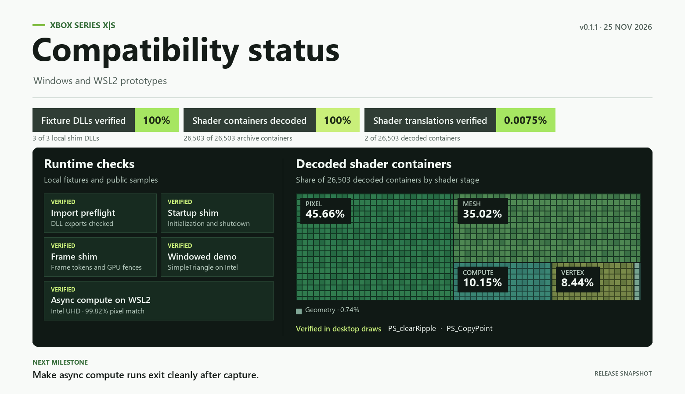

# Xbox Linux Compatibility

Experimental tooling and compatibility tests for Xbox Series X|S software on desktop PCs. The long-term goal is a bootable Linux gaming distro with a controller-first library and the compatibility runtime built in.

## Version 0.1.1

| Check | Result |
| --- | --- |
| Windows startup and graphics shims | SimpleTriangle rendered through the local Direct3D 12 fixtures. The harness checks imports, frame tokens, and fence completion. |
| Windows shader proofs | Two pixel shader profiles passed DXIL validation, WARP pipeline creation, and pixel readback. |
| Public OpenScarlett samples on Ubuntu 24.04 WSL2 | SimpleTriangle and SimpleTexture presented at 3840 × 2160. SimpleCompute rendered a 1920 × 1080 fractal in synchronous and async modes on llvmpipe. |
| Async compute on Intel UHD Graphics in WSL2 | Wine 10.14 and Mesa Dozen rendered the fractal on the physical GPU. The compute fence completed and 99.82% of pixels matched the llvmpipe async frame exactly. The process timed out after capture. |

The WSL2 runs use public OpenScarlett v0.6.0-alpha samples and compatibility shims. Those sample results measure that stack on the test PC. Commercial title compatibility remains untested. [OpenScarlett release](https://github.com/californiaAlmonds/OpenScarlett/releases/tag/v0.6.0-alpha)



## Use the tools

- [PE import checker](inspection/xbox-import-checker/check_imports.py) and [loader preflight](inspection/simpletriangle-loader/loader.py) inspect local executable and DLL files. Preflight reads the files as data.
- [Windows fixtures](inspection/simpletriangle-loader/usage.txt) exercise the project’s startup and frame shims.
- [Shader tools](inspection/shader-proof/README.md) parse shader containers and exercise the two desktop pixel shader proofs.
- [WSL2 async compute](docs/wsl-async-compute.md) records adapter selection, the frame comparison, and how to reproduce the test.

### Windows fixture quick start

Use PowerShell, Python 3, Visual Studio x64 C++ tools, and the Windows SDK with DXC. Set `$dxc` to the full path of the SDK’s x64 `dxc.exe` before running these commands from the repo root.

```powershell
python -B -m unittest discover -s inspection -p 'test_*.py'

& $dxc -T ps_6_0 -E main -Fo inspection/shader-proof/clear_ripple.dxil inspection/shader-proof/clear_ripple.hlsl
& $dxc -T ps_6_0 -E main -Fo inspection/texture-proof/copy_point.dxil inspection/texture-proof/copy_point.hlsl
& ./inspection/shader-proof/build_pixel.ps1 -Dxc $dxc
& ./inspection/texture-proof/build_texture.ps1 -Dxc $dxc
& ./inspection/shader-validation/run.ps1

& ./inspection/xbox-style-triangle/build.ps1 -Dxc $dxc
& ./inspection/xbox-style-triangle/bin/xbox_style_triangle.exe --warp --microsoft
& ./inspection/simpletriangle-loader/shims/build.ps1
& ./inspection/simpletriangle-loader/loader.ps1 shim-fixture --adapter warp
```

The triangle executable verifies each pixel against a CPU reference and saves the BMP used by the loader for its comparison. Run `loader.ps1 preflight <path-to-an-exe-or-unpacked-build>` to inventory a local build.

Two MIT-licensed Microsoft SimpleTriangle shaders are included with their [license](inspection/Xbox-GDK-Samples/LICENSE). Their upstream source is pinned to the [Microsoft sample checkout](https://github.com/microsoft/Xbox-GDK-Samples/tree/b1e77b6ac10f95b07296025fda171ca2ddc42dbe/Samples/IntroGraphics/SimpleTriangle).

## Next milestone for 0.1.2

Fix the async compute shutdown path after frame capture. The target is a repeatable WSL2 run that verifies the Intel adapter, completes an async dispatch, captures the fractal, and exits cleanly.

See the [changelog](CHANGELOG.md).
